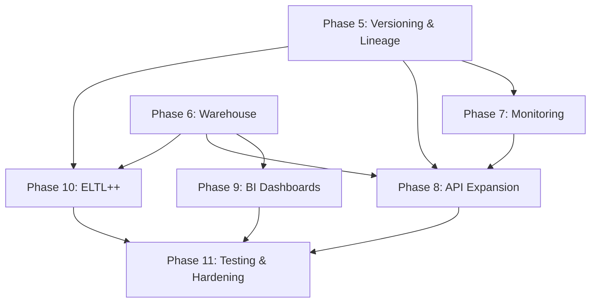

# Product Requirements Document (PRD)

## Design and Implementation of an Automated End-to-End Data Pipeline and Business Intelligence Architecture

> **B.Tech CSE (Data Science) — Major Project | Batch 19**
> **Document Version:** 1.0 | **Date:** September 28, 2026

> [!NOTE]
> **Status update (October 27, 2026):** Phases 1–10 are implemented, including
> the BI layer as portable deliverables (CSV extracts, KPI summary, and a
> standalone HTML outcome report) plus Power BI / Tableau connection guides.
> Phase 11 production hardening is largely complete; see the checklist in
> [`docs/project/implementation.md`](docs/project/implementation.md). The
> per-phase status markers below preserve the original audit and are stale in
> places. For the repeatable outcome demonstration, see
> [`docs/project/demo_guide.md`](docs/project/demo_guide.md).

---

## Table of Contents

1. [Executive Summary](#1-executive-summary)
2. [Current State Assessment](#2-current-state-assessment)
3. [Tool & Environment Setup Guide](#3-tool--environment-setup-guide)
4. [Phase 1 — Foundation & Project Scaffolding](#4-phase-1--foundation--project-scaffolding)
5. [Phase 2 — Data Ingestion Layer](#5-phase-2--data-ingestion-layer)
6. [Phase 3 — Data Contracts & Schema Validation](#6-phase-3--data-contracts--schema-validation)
7. [Phase 4 — Pipeline Orchestration & T2 Transformation](#7-phase-4--pipeline-orchestration--t2-transformation)
8. [Phase 5 — Data Versioning, Lineage & Checkpointing](#8-phase-5--data-versioning-lineage--checkpointing)
9. [Phase 6 — Data Warehouse & Dimensional Modeling](#9-phase-6--data-warehouse--dimensional-modeling)
10. [Phase 7 — Monitoring, Observability & Quality Metrics](#10-phase-7--monitoring-observability--quality-metrics)
11. [Phase 8 — REST API (Backend) — Pipeline Monitoring & Control](#11-phase-8--rest-api-backend--pipeline-monitoring--control)
12. [Phase 9 — Business Intelligence Layer (BI Dashboards)](#12-phase-9--business-intelligence-layer-bi-dashboards)
13. [Phase 10 — ELTL++ Pipeline Implementation](#13-phase-10--eltl-pipeline-implementation)
14. [Phase 11 — Testing, CI/CD & Production Hardening](#14-phase-11--testing-cicd--production-hardening)
15. [Implementation Timeline & Effort Estimates](#15-implementation-timeline--effort-estimates)
16. [Appendix — Full File Reference Map](#16-appendix--full-file-reference-map)

---

## 1. Executive Summary

This project implements a **production-grade, automated data engineering and Business Intelligence platform**. The system ingests data from heterogeneous sources (APIs, CSV, Excel, RDBMS), validates it against versioned data contracts, transforms it through business logic, stores it in a layered data warehouse (PostgreSQL / Snowflake), and delivers curated analytical datasets to Power BI and Tableau dashboards.

### Key Architectural Patterns

| Pattern | Flow |
|---------|------|
| **ETLT++** | Extract → Contract Validate → Clean/Transform → Versioned Raw → Business Transform → Curated → BI |
| **ELTL++** | Extract → Raw Load (Immutable) → Managed Raw → Transform → Curated Semantic → BI |

### Cross-Cutting Concerns
- Data Governance & Contracts
- Data Lineage & Metadata
- Observability & Monitoring
- Error Handling & Quarantine

---

## 2. Current State Assessment

After a thorough audit of the codebase, here is the **implementation status** of every module:

### ✅ Fully Implemented (Phases 1–4)

| Module | Files | Status |
|--------|-------|--------|
| Project scaffolding | `pyproject.toml`, `Makefile`, `.gitignore`, `docker-compose.yml` | ✅ Complete |
| Configuration system | `config/settings.yaml`, `config/pipeline.yaml`, `config/logging.yaml`, `config/environments/` | ✅ Complete |
| Environment management | `.env.example`, `src/utils/config.py` | ✅ Complete |
| Logger & utilities | `src/utils/logger.py`, `src/utils/file_utils.py`, `src/utils/hashing.py`, `src/utils/timestamps.py` | ✅ Complete |
| CSV Ingestion | `src/ingestion/csv_ingestion.py` | ✅ Complete |
| Excel Ingestion | `src/ingestion/excel_ingestion.py` | ✅ Complete |
| API Ingestion | `src/ingestion/api_ingestion.py` | ✅ Complete |
| Database Ingestion | `src/ingestion/database_ingestion.py` | ✅ Complete |
| Ingestion Factory | `src/ingestion/ingestion_factory.py` | ✅ Complete |
| Contract Loader | `src/contracts/contract_loader.py` | ✅ Complete |
| Contract Registry | `src/contracts/contract_registry.py` | ✅ Complete |
| Schema Validator | `src/contracts/schema_validator.py` | ✅ Complete |
| Contract Validator | `src/contracts/contract_validator.py` | ✅ Complete |
| Validation Service | `src/contracts/validation_service.py` | ✅ Complete |
| Validation Result | `src/contracts/validation_result.py` | ✅ Complete |
| Quarantine Manager | `src/errors/quarantine_manager.py` | ✅ Complete |
| Error Handling | `src/errors/error_handler.py`, `src/errors/exceptions.py` | ✅ Complete |
| Data Cleaning | `src/transformation/cleaning.py` | ✅ Complete |
| Normalization | `src/transformation/normalization.py` | ✅ Complete |
| Deduplication | `src/transformation/deduplication.py` | ✅ Complete |
| Business Rules | `src/transformation/business_rules.py` | ✅ Complete |
| Transformation Service | `src/transformation/transformation_factory.py` | ✅ Complete |
| Raw Storage | `src/storage/raw_storage.py` | ✅ Complete |
| Curated Storage | `src/storage/curated_storage.py` | ✅ Complete |
| ETLT++ Pipeline | `src/pipelines/etlt_plus_plus.py` | ✅ Complete |
| Pipeline Runner | `src/pipelines/pipeline_runner.py` | ✅ Complete |
| Pipeline Registry | `src/pipelines/pipeline_registry.py` | ✅ Complete |
| FastAPI Health & Sample Data | `api/main.py`, `api/routes/health.py`, `api/routes/sample_data.py` | ✅ Complete |
| SQL Schema Creation | `sql/postgres/01–03*.sql` | ✅ Complete |
| Unit Tests | `tests/unit/` (9 files) | ✅ Complete |
| Integration Tests | `tests/integration/` (4 files) | ✅ Complete |

### 🟡 Scaffolding Only (Need Implementation)

| Module | Files | Status |
|--------|-------|--------|
| Data Versioning (SCD2) | `src/storage/versioning.py` | 🟡 Scaffolding |
| Checkpoint Manager | `src/storage/checkpoint_manager.py` | 🟡 Scaffolding |
| Lineage Tracker | `src/lineage/lineage_tracker.py` | 🟡 Scaffolding |
| Lineage Store | `src/lineage/lineage_store.py` | 🟡 Scaffolding |
| Metadata Collector | `src/lineage/metadata_collector.py` | 🟡 Scaffolding |
| Freshness Monitor | `src/monitoring/freshness.py` | 🟡 Scaffolding |
| Completeness Monitor | `src/monitoring/completeness.py` | 🟡 Scaffolding |
| Accuracy Monitor | `src/monitoring/accuracy.py` | 🟡 Scaffolding |
| Contract Adherence | `src/monitoring/contract_adherence.py` | 🟡 Scaffolding |
| Quality Metrics | `src/monitoring/quality_metrics.py` | 🟡 Scaffolding |
| Pipeline Metrics | `src/monitoring/pipeline_metrics.py` | 🟡 Scaffolding |
| Alert Manager | `src/monitoring/alert_manager.py` | 🟡 Scaffolding |
| Monitoring Logger | `src/monitoring/monitoring_logger.py` | 🟡 Scaffolding |
| ELTL++ Pipeline | `src/pipelines/eltl_plus_plus.py` | 🟡 Scaffolding |
| Basic ETLT Pipeline | `src/pipelines/etlt_pipeline.py` | 🟡 Scaffolding |
| Basic ELTL Pipeline | `src/pipelines/eltl_pipeline.py` | 🟡 Scaffolding |
| API — Pipeline Routes | `api/routes/pipelines.py` | 🟡 Scaffolding |
| API — Data Quality Routes | `api/routes/data_quality.py` | 🟡 Scaffolding |
| API — Lineage Routes | `api/routes/lineage.py` | 🟡 Scaffolding |
| Dimension Tables SQL | `sql/postgres/04_create_dimensions.sql` | 🟡 Commented out |
| Fact Tables SQL | `sql/postgres/05_create_facts.sql` | 🟡 Commented out |
| Views SQL | `sql/postgres/06_create_views.sql` | 🟡 Needs content |
| Warehouse Python Modules | `src/warehouse/dimensions/`, `facts/`, `marts/`, `staging/`, `views/` | 🟡 `.gitkeep` only |
| Snowflake SQL Scripts | `sql/snowflake/01–06*.sql` | 🟡 Placeholder files |
| Dashboard Docs | `dashboard/powerbi/`, `dashboard/tableau/` | 🟡 Empty directories |
| Enrichment | `src/transformation/enrichment.py` | 🟡 Scaffolding |
| Type Conversion | `src/transformation/type_conversion.py` | 🟡 Scaffolding |
| Storage — Postgres Module | `src/storage/postgres/` | 🟡 Not yet populated |
| Storage — Snowflake Module | `src/storage/snowflake/` | 🟡 Not yet populated |
| Orchestration Jobs | `orchestration/jobs/` | 🟡 Partially scaffolded |
| Orchestration Schedules | `orchestration/schedules/` | 🟡 Empty |

---

## 3. Tool & Environment Setup Guide

### 3.1 Required Software Installations

| Tool | Version | Purpose | Install Command / Link |
|------|---------|---------|----------------------|
| **Python** | 3.10+ | Core language | [python.org](https://www.python.org/downloads/) |
| **Git** | Latest | Version control | [git-scm.com](https://git-scm.com/downloads) |
| **Docker Desktop** | Latest | Container runtime | [docker.com](https://www.docker.com/products/docker-desktop/) |
| **Docker Compose** | v2+ (bundled) | Service orchestration | Bundled with Docker Desktop |
| **PostgreSQL Client** | 16+ | Database access/testing | Bundled via Docker; optional local: `choco install postgresql` |
| **VS Code** | Latest | IDE | [code.visualstudio.com](https://code.visualstudio.com/) |
| **Power BI Desktop** | Latest | BI dashboards | [Microsoft Store](https://apps.microsoft.com/store/detail/power-bi-desktop/9NTXR16HNW1T) |
| **Tableau Public/Desktop** | Latest | BI visualizations | [tableau.com](https://www.tableau.com/products/public/download) |
| **pgAdmin 4** | Latest | PostgreSQL GUI | [pgadmin.org](https://www.pgadmin.org/download/) |
| **Postman / Insomnia** | Latest | API testing | [postman.com](https://www.postman.com/downloads/) |
| **DBeaver** *(optional)* | Latest | Universal DB client | [dbeaver.io](https://dbeaver.io/download/) |

### 3.2 Python Virtual Environment Setup

```powershell
# Navigate to the project root
cd d:\Major_Project_batch19\Automated-End-to-End-Pipeline

# Create virtual environment
python -m venv .venv

# Activate (Windows PowerShell)
.venv\Scripts\Activate.ps1

# Install all dependencies
pip install -r requirements.txt

# Verify installation
python -c "import pandas; import fastapi; import sqlalchemy; print('All packages OK')"
```

### 3.3 Docker & PostgreSQL Setup

```powershell
# Start PostgreSQL container
docker-compose up -d

# Verify the container is running
docker ps

# Test connection (from host)
# Default credentials: pipeline_user / pipeline_password @ localhost:5432 / pipeline_warehouse
```

### 3.4 Environment Configuration

```powershell
# Copy the template
copy .env.example .env

# Edit .env and fill in:
#   POSTGRES_USER=pipeline_user
#   POSTGRES_PASSWORD=pipeline_password
#   (other vars as needed)
```

### 3.5 Database Initialization

```powershell
python scripts/setup_database.py
```

### 3.6 Validate Everything

```powershell
python scripts/validate_environment.py
```

### 3.7 VS Code Recommended Extensions

| Extension | Purpose |
|-----------|---------|
| Python (ms-python) | Python IntelliSense, linting, debugging |
| Pylance | Advanced type checking |
| Docker | Manage containers from VS Code |
| PostgreSQL (cweijan) | Database explorer |
| REST Client | Test APIs directly from `.http` files |
| GitLens | Git blame, history |
| YAML | YAML highlighting & validation |

---

## 4. Phase 1 — Foundation & Project Scaffolding

> **Status: ✅ COMPLETE**

### 4.1 Objective
Establish the project skeleton, directory structure, configuration system, and development environment.

### 4.2 What Was Done

#### Backend

| Task | File(s) | Details |
|------|---------|---------|
| Project metadata | [`pyproject.toml`](file:///d:/Major_Project_batch19/Automated-End-to-End-Pipeline/pyproject.toml) | Package name, version, Python requirement, optional dependencies |
| Dependency list | [`requirements.txt`](file:///d:/Major_Project_batch19/Automated-End-to-End-Pipeline/requirements.txt) | pandas, numpy, openpyxl, requests, sqlalchemy, psycopg2, pydantic, fastapi, uvicorn, pytest |
| Build automation | [`Makefile`](file:///d:/Major_Project_batch19/Automated-End-to-End-Pipeline/Makefile) | Commands: `setup`, `install`, `run`, `test`, `docker-up`, `docker-down`, `db-setup`, `api`, `clean` |
| Docker infrastructure | [`docker-compose.yml`](file:///d:/Major_Project_batch19/Automated-End-to-End-Pipeline/docker-compose.yml) | PostgreSQL 16 Alpine with healthcheck, persistent volume, init script |
| Configuration | [`config/settings.yaml`](file:///d:/Major_Project_batch19/Automated-End-to-End-Pipeline/config/settings.yaml) | App settings, data paths, database schemas, API config, quality thresholds |
| Pipeline config | [`config/pipeline.yaml`](file:///d:/Major_Project_batch19/Automated-End-to-End-Pipeline/config/pipeline.yaml) | ETLT++, ELTL++, basic ETLT, basic ELTL definitions with stage lists, retry, checkpoint settings |
| Logging config | [`config/logging.yaml`](file:///d:/Major_Project_batch19/Automated-End-to-End-Pipeline/config/logging.yaml) | Multi-handler logging: console + rotating file |
| Environment profiles | [`config/environments/`](file:///d:/Major_Project_batch19/Automated-End-to-End-Pipeline/config/environments/) | `development.yaml`, `testing.yaml`, `production.yaml` |
| Environment vars template | [`.env.example`](file:///d:/Major_Project_batch19/Automated-End-to-End-Pipeline/.env.example) | All configurable env vars with documentation |
| Core utilities | `src/utils/` | `config.py` (env loader, connection strings), `logger.py` (setup_logging, get_logger), `file_utils.py` (path builders), `hashing.py`, `timestamps.py`, `validation_utils.py` |
| Data zone directories | `data/` | `raw/`, `staging/`, `processed/`, `curated/`, `quarantine/`, `archive/` |
| Log directories | `logs/` | `pipeline/`, `validation/`, `lineage/`, `errors/` |

#### Steps to Complete (If Not Done)

1. Clone the repository and verify the directory tree matches the structure in the README.
2. Create `.env` from `.env.example` and fill in PostgreSQL credentials.
3. Run `docker-compose up -d` to start PostgreSQL.
4. Run `python scripts/setup_database.py` to create schemas.
5. Run `python scripts/validate_environment.py` to confirm everything works.

---

## 5. Phase 2 — Data Ingestion Layer

> **Status: ✅ COMPLETE**

### 5.1 Objective
Build modular ingestion adapters that can extract data from CSV, Excel, REST APIs, and relational databases using a unified factory interface.

### 5.2 Architecture

```
┌─────────────────────────────────────────────┐
│              BaseIngestion (ABC)             │
│   extract() → DataFrame                     │
│   source_type → str                         │
│   source_name → str                         │
├─────────────┬──────────┬──────────┬─────────┤
│ CSVIngestion│ExcelIng. │APIIng.   │DBIng.   │
└─────────────┴──────────┴──────────┴─────────┘
        ↑
  IngestionFactory.create_ingestion(source_type, **kwargs)
```

### 5.3 Backend Implementation

| Component | File | Key Implementation Details |
|-----------|------|---------------------------|
| Abstract base class | [`src/ingestion/base.py`](file:///d:/Major_Project_batch19/Automated-End-to-End-Pipeline/src/ingestion/base.py) | ABC with `extract()`, `source_type`, `source_name` abstract methods |
| CSV adapter | [`src/ingestion/csv_ingestion.py`](file:///d:/Major_Project_batch19/Automated-End-to-End-Pipeline/src/ingestion/csv_ingestion.py) | `pd.read_csv()` with configurable encoding/delimiter; raises `IngestionError` on failure |
| Excel adapter | [`src/ingestion/excel_ingestion.py`](file:///d:/Major_Project_batch19/Automated-End-to-End-Pipeline/src/ingestion/excel_ingestion.py) | `pd.read_excel()` with openpyxl engine; supports sheet selection |
| API adapter | [`src/ingestion/api_ingestion.py`](file:///d:/Major_Project_batch19/Automated-End-to-End-Pipeline/src/ingestion/api_ingestion.py) | HTTP GET via `requests`; configurable timeout, headers, auth; JSON → DataFrame |
| Database adapter | [`src/ingestion/database_ingestion.py`](file:///d:/Major_Project_batch19/Automated-End-to-End-Pipeline/src/ingestion/database_ingestion.py) | SQLAlchemy `pd.read_sql()`; configurable connection string, query/table |
| Factory | [`src/ingestion/ingestion_factory.py`](file:///d:/Major_Project_batch19/Automated-End-to-End-Pipeline/src/ingestion/ingestion_factory.py) | `create_ingestion(source_type, **kwargs)` → returns correct adapter |
| Raw storage | [`src/storage/raw_storage.py`](file:///d:/Major_Project_batch19/Automated-End-to-End-Pipeline/src/storage/raw_storage.py) | Saves to `data/raw/<source>/<dataset>/<batch_id>.csv` |
| Custom exceptions | [`src/errors/exceptions.py`](file:///d:/Major_Project_batch19/Automated-End-to-End-Pipeline/src/errors/exceptions.py) | `IngestionError`, `ValidationError`, `TransformationError`, `StorageError` |

### 5.4 Test Data

| File | Purpose |
|------|---------|
| [`tests/fixtures/sample_transactions.csv`](file:///d:/Major_Project_batch19/Automated-End-to-End-Pipeline/tests/fixtures/sample_transactions.csv) | ~100 valid transaction records |
| [`tests/fixtures/sample_transactions.xlsx`](file:///d:/Major_Project_batch19/Automated-End-to-End-Pipeline/tests/fixtures/sample_transactions.xlsx) | Same data in Excel format |
| [`tests/fixtures/invalid_transactions.csv`](file:///d:/Major_Project_batch19/Automated-End-to-End-Pipeline/tests/fixtures/invalid_transactions.csv) | Records with deliberate errors |
| [`tests/fixtures/valid_data.csv`](file:///d:/Major_Project_batch19/Automated-End-to-End-Pipeline/tests/fixtures/valid_data.csv) | Clean test data |
| [`tests/fixtures/invalid_data.csv`](file:///d:/Major_Project_batch19/Automated-End-to-End-Pipeline/tests/fixtures/invalid_data.csv) | Invalid test data |

### 5.5 Steps to Verify

```powershell
# Test CSV ingestion
pytest tests/unit/test_ingestion.py -v

# Manual test
python -c "
from src.ingestion.ingestion_factory import create_ingestion
adapter = create_ingestion('csv', file_path='tests/fixtures/sample_transactions.csv')
df = adapter.extract()
print(f'Records: {len(df)}, Columns: {list(df.columns)}')
"
```

---

## 6. Phase 3 — Data Contracts & Schema Validation

> **Status: ✅ COMPLETE**

### 6.1 Objective
Enforce data quality through JSON-based, versioned data contracts that define structural schema rules and row-level field validation.

### 6.2 Contract Structure

```json
{
  "dataset": "transactions",
  "version": "1.0",
  "description": "Retail transaction records...",
  "fields": {
    "transaction_id": { "type": "string", "required": true, "nullable": false },
    "quantity":       { "type": "integer", "required": true, "minimum": 1 },
    "unit_price":     { "type": "number",  "minimum": 0 },
    "location":       { "type": "string",  "allowed_values": ["NYC", "LA", ...] },
    "transaction_date": { "type": "date", "format": "YYYY-MM-DD" }
  }
}
```

### 6.3 Backend Implementation

| Component | File | Details |
|-----------|------|---------|
| Contract schema definition | [`contracts/schemas/transaction_contract.json`](file:///d:/Major_Project_batch19/Automated-End-to-End-Pipeline/contracts/schemas/transaction_contract.json) | 8-field contract for transaction dataset |
| Contract versioning | [`contracts/versions/v1/`](file:///d:/Major_Project_batch19/Automated-End-to-End-Pipeline/contracts/versions/v1/) | Versioned snapshots of contracts |
| Contract Loader | [`src/contracts/contract_loader.py`](file:///d:/Major_Project_batch19/Automated-End-to-End-Pipeline/src/contracts/contract_loader.py) | Loads JSON contracts from filesystem, resolves versions |
| Contract Registry | [`src/contracts/contract_registry.py`](file:///d:/Major_Project_batch19/Automated-End-to-End-Pipeline/src/contracts/contract_registry.py) | Central registry for dataset→contract mapping |
| Schema Validator | [`src/contracts/schema_validator.py`](file:///d:/Major_Project_batch19/Automated-End-to-End-Pipeline/src/contracts/schema_validator.py) | Structural checks: missing columns, unexpected columns |
| Contract Validator | [`src/contracts/contract_validator.py`](file:///d:/Major_Project_batch19/Automated-End-to-End-Pipeline/src/contracts/contract_validator.py) | Row-level validation: types, nullability, ranges, allowed values, formats |
| Validation Result | [`src/contracts/validation_result.py`](file:///d:/Major_Project_batch19/Automated-End-to-End-Pipeline/src/contracts/validation_result.py) | `ValidationResult` and `ValidationErrorMetadata` data classes |
| Validation Service | [`src/contracts/validation_service.py`](file:///d:/Major_Project_batch19/Automated-End-to-End-Pipeline/src/contracts/validation_service.py) | Orchestrator: loads contract → validates → splits valid/invalid → quarantines |
| Quarantine Manager | [`src/errors/quarantine_manager.py`](file:///d:/Major_Project_batch19/Automated-End-to-End-Pipeline/src/errors/quarantine_manager.py) | Saves invalid records + JSON metadata to `data/quarantine/validation_errors/<dataset>/` |
| SQL: Validation tables | [`sql/postgres/03_create_validation_tables.sql`](file:///d:/Major_Project_batch19/Automated-End-to-End-Pipeline/sql/postgres/03_create_validation_tables.sql) | PostgreSQL tables for validation audit logging |

### 6.4 Validation Rules Supported

| Rule | Check | Action on Failure |
|------|-------|-------------------|
| `nullable: false` | Field must not be null/NaN | Record marked invalid |
| `type` | Value must match expected type (string, integer, number, boolean, date) | Record marked invalid |
| `minimum` / `maximum` | Numeric value within range | Record marked invalid |
| `allowed_values` | Value in enumerated list | Record marked invalid |
| `format` | Date format validation (e.g., YYYY-MM-DD) | Record marked invalid |
| `required: true` (schema) | Column must exist in DataFrame | All records fail (critical) |

### 6.5 Steps to Verify

```powershell
pytest tests/unit/test_contract_validator.py tests/unit/test_schema_validator.py tests/unit/test_validation.py -v
```

---

## 7. Phase 4 — Pipeline Orchestration & T2 Transformation

> **Status: ✅ COMPLETE**

### 7.1 Objective
Build the unified `PipelineRunner` engine and implement the full ETLT++ flow including T2 business transformations.

### 7.2 ETLT++ Pipeline Flow

```
┌──────────┐    ┌───────────┐    ┌──────────────┐    ┌─────────────┐    ┌────────────┐
│ EXTRACT  │───▶│ RAW STORE │───▶│ T1 VALIDATE  │───▶│ T2 TRANSFORM│───▶│  CURATED   │
│ (Source)  │    │ (Immutable)│    │ (Contract)   │    │ (Business)  │    │  STORAGE   │
└──────────┘    └───────────┘    │  ↓ invalid   │    └─────────────┘    │  (Parquet)  │
                                  │ QUARANTINE   │                       └────────────┘
                                  └──────────────┘
```

### 7.3 Backend Implementation

| Component | File | Details |
|-----------|------|---------|
| ETLT++ Pipeline | [`src/pipelines/etlt_plus_plus.py`](file:///d:/Major_Project_batch19/Automated-End-to-End-Pipeline/src/pipelines/etlt_plus_plus.py) | 5-step execute(): extract → raw store → T1 validate → T2 transform → curated store |
| Pipeline Runner | [`src/pipelines/pipeline_runner.py`](file:///d:/Major_Project_batch19/Automated-End-to-End-Pipeline/src/pipelines/pipeline_runner.py) | Unified engine: resolves pipeline by name, generates execution_id, measures duration, handles errors |
| Pipeline Registry | [`src/pipelines/pipeline_registry.py`](file:///d:/Major_Project_batch19/Automated-End-to-End-Pipeline/src/pipelines/pipeline_registry.py) | Dynamic registry mapping pipeline names → classes |
| Transformation Service | [`src/transformation/transformation_factory.py`](file:///d:/Major_Project_batch19/Automated-End-to-End-Pipeline/src/transformation/transformation_factory.py) | Orchestrates: Clean → Normalize → Deduplicate → Business Rules |
| Data Cleaner | [`src/transformation/cleaning.py`](file:///d:/Major_Project_batch19/Automated-End-to-End-Pipeline/src/transformation/cleaning.py) | Strip whitespace, standardize strings |
| Normalizer | [`src/transformation/normalization.py`](file:///d:/Major_Project_batch19/Automated-End-to-End-Pipeline/src/transformation/normalization.py) | Format standardization (dates, currencies, text case) |
| Deduplicator | [`src/transformation/deduplication.py`](file:///d:/Major_Project_batch19/Automated-End-to-End-Pipeline/src/transformation/deduplication.py) | Remove exact and business-key duplicates |
| Business Rule Engine | [`src/transformation/business_rules.py`](file:///d:/Major_Project_batch19/Automated-End-to-End-Pipeline/src/transformation/business_rules.py) | Derived field calculations, categorization |
| Curated Storage | [`src/storage/curated_storage.py`](file:///d:/Major_Project_batch19/Automated-End-to-End-Pipeline/src/storage/curated_storage.py) | Saves to `data/curated/<dataset>/<batch_id>.parquet` (with CSV fallback) |
| CLI Runner | [`scripts/run_pipeline.py`](file:///d:/Major_Project_batch19/Automated-End-to-End-Pipeline/scripts/run_pipeline.py) | CLI: `python scripts/run_pipeline.py --pipeline etlt_plus_plus --source csv --file <path>` |

### 7.4 Steps to Run the Pipeline

```powershell
# Full ETLT++ execution from CSV source
python scripts/run_pipeline.py \
  --pipeline etlt_plus_plus \
  --source csv \
  --file tests/fixtures/sample_transactions.csv \
  --dataset transactions \
  --contract-version 1.0
```

**Expected output:**
```json
{
  "pipeline": "etlt_plus_plus",
  "execution_id": "exec_abc123def456",
  "status": "SUCCESS",
  "duration_seconds": 1.23,
  "details": {
    "extracted": 100,
    "raw_path": "data/raw/csv/transactions/exec_abc123def456.csv",
    "validation_status": "PASS",
    "valid_records": 95,
    "invalid_records": 5,
    "transformed_records": 93,
    "curated_path": "data/curated/transactions/exec_abc123def456.parquet"
  }
}
```

### 7.5 Steps to Verify

```powershell
pytest tests/integration/test_etlt_plus_plus.py -v
pytest tests/unit/test_transformation.py -v
```

---

## 8. Phase 5 — Data Versioning, Lineage & Checkpointing

> **Status: 🟡 SCAFFOLDING — NEEDS IMPLEMENTATION**

### 8.1 Objective
Implement append-only versioned storage with SCD Type 2, pipeline lineage tracking, and checkpoint-based recovery.

### 8.2 Backend Implementation Plan

#### 8.2.1 Data Versioning ([`src/storage/versioning.py`](file:///d:/Major_Project_batch19/Automated-End-to-End-Pipeline/src/storage/versioning.py))

**Implementation steps:**

1. **Define `VersionedRecord` dataclass:**
   ```python
   @dataclass
   class VersionedRecord:
       record_id: str
       source_system: str
       batch_id: str
       ingestion_timestamp: datetime
       valid_from: datetime
       valid_to: Optional[datetime]  # None = current
       record_hash: str
       schema_version: str
       is_current: bool = True
   ```

2. **Implement `RecordHasher`:**
   - Use `src/utils/hashing.py` to compute SHA-256 of record content
   - Skip metadata columns (batch_id, timestamps) from hash

3. **Implement SCD Type 2 versioning:**
   - On new batch: compare `record_hash` with previous version
   - If changed: expire old record (`valid_to = now, is_current = False`), insert new version
   - If unchanged: skip (no duplicate)
   - If new: insert with `valid_from = now, is_current = True`

4. **Add version comparison utilities:**
   - `get_current_version(record_id)` → latest active record
   - `get_version_history(record_id)` → all versions sorted by `valid_from`
   - `rollback_to_version(record_id, version_timestamp)`

#### 8.2.2 Lineage Tracker ([`src/lineage/lineage_tracker.py`](file:///d:/Major_Project_batch19/Automated-End-to-End-Pipeline/src/lineage/lineage_tracker.py))

**Implementation steps:**

1. **Define `LineageEvent` dataclass:**
   ```python
   @dataclass
   class LineageEvent:
       event_id: str
       batch_id: str
       pipeline_name: str
       stage: str                # e.g., "extract", "validate", "transform"
       source_system: str
       dataset_name: str
       contract_version: str
       input_record_count: int
       output_record_count: int
       timestamp: datetime
       metadata: dict            # stage-specific info
   ```

2. **Implement stage-level recording:**
   - Add `LineageTracker.record_event()` calls inside each pipeline step
   - Call from `ETLTPlusPlusPipeline.execute()` after each stage

3. **Implement source-to-destination graph:**
   - Track: Source → Raw → Validated → Transformed → Curated → Warehouse table
   - Store in `metadata` PostgreSQL schema

#### 8.2.3 Lineage Store ([`src/lineage/lineage_store.py`](file:///d:/Major_Project_batch19/Automated-End-to-End-Pipeline/src/lineage/lineage_store.py))

- Persist lineage events to `metadata.lineage_events` table
- Add query methods: `get_lineage_by_batch()`, `get_lineage_by_dataset()`

#### 8.2.4 Metadata Collector ([`src/lineage/metadata_collector.py`](file:///d:/Major_Project_batch19/Automated-End-to-End-Pipeline/src/lineage/metadata_collector.py))

- Collect schema metadata (column names, types, row counts)
- Collect pipeline metadata (duration, status, error count)
- Store in `metadata` schema

#### 8.2.5 Checkpoint Manager ([`src/storage/checkpoint_manager.py`](file:///d:/Major_Project_batch19/Automated-End-to-End-Pipeline/src/storage/checkpoint_manager.py))

**Implementation steps:**

1. **Define checkpoint structure:**
   ```python
   @dataclass
   class Checkpoint:
       execution_id: str
       pipeline_name: str
       last_completed_stage: str
       timestamp: datetime
       state: dict                # Serializable pipeline state
   ```

2. **Save checkpoint after each stage:**
   - Serialize current pipeline state to JSON
   - Save to `data/staging/checkpoints/<execution_id>.json`

3. **Restore from checkpoint:**
   - `CheckpointManager.get_latest(pipeline_name)` → latest checkpoint
   - `CheckpointManager.restore(execution_id)` → resume from last stage

4. **Add cleanup:**
   - Retention policy: keep last N checkpoints per pipeline
   - `CheckpointManager.cleanup(retention_days=7)`

### 8.3 SQL Tables Needed

```sql
-- In metadata schema
CREATE TABLE IF NOT EXISTS metadata.lineage_events (
    event_id VARCHAR(50) PRIMARY KEY,
    batch_id VARCHAR(100) NOT NULL,
    pipeline_name VARCHAR(100) NOT NULL,
    stage VARCHAR(50) NOT NULL,
    source_system VARCHAR(100),
    dataset_name VARCHAR(100),
    contract_version VARCHAR(20),
    input_record_count INTEGER,
    output_record_count INTEGER,
    event_timestamp TIMESTAMP WITH TIME ZONE DEFAULT NOW(),
    metadata JSONB
);

CREATE TABLE IF NOT EXISTS metadata.data_versions (
    id SERIAL PRIMARY KEY,
    record_id VARCHAR(255) NOT NULL,
    source_system VARCHAR(100),
    batch_id VARCHAR(100),
    ingestion_timestamp TIMESTAMP WITH TIME ZONE,
    valid_from TIMESTAMP WITH TIME ZONE NOT NULL,
    valid_to TIMESTAMP WITH TIME ZONE,
    record_hash VARCHAR(64) NOT NULL,
    schema_version VARCHAR(20),
    is_current BOOLEAN DEFAULT TRUE
);

CREATE TABLE IF NOT EXISTS metadata.checkpoints (
    execution_id VARCHAR(50) PRIMARY KEY,
    pipeline_name VARCHAR(100) NOT NULL,
    last_completed_stage VARCHAR(50) NOT NULL,
    checkpoint_timestamp TIMESTAMP WITH TIME ZONE DEFAULT NOW(),
    state JSONB
);
```

### 8.4 Steps to Implement

1. Create the SQL tables above → add to `sql/postgres/` and run via `setup_database.py`
2. Implement `VersionedRecord` and SCD2 logic in `src/storage/versioning.py`
3. Implement `LineageEvent` and tracker in `src/lineage/lineage_tracker.py`
4. Implement `LineageStore` persistence in `src/lineage/lineage_store.py`
5. Implement `MetadataCollector` in `src/lineage/metadata_collector.py`
6. Implement `CheckpointManager` in `src/storage/checkpoint_manager.py`
7. Integrate lineage calls into `ETLTPlusPlusPipeline.execute()`
8. Integrate checkpoint save/restore into `PipelineRunner.run()`
9. Write unit tests in `tests/unit/test_versioning.py`, `test_lineage.py`, `test_checkpoint.py`
10. Write integration test in `tests/integration/test_lineage_pipeline.py`

---

## 9. Phase 6 — Data Warehouse & Dimensional Modeling

> **Status: 🟡 SCAFFOLDING — NEEDS IMPLEMENTATION**

### 9.1 Objective
Build the star schema warehouse with dimension tables, fact tables, staging procedures, and analytical marts/views.

### 9.2 Star Schema Design

```
                     ┌─────────────┐
                     │  dim_date   │
                     └──────┬──────┘
                            │
┌─────────────┐    ┌────────┴────────┐    ┌─────────────┐
│dim_customer │────│fact_transactions│────│ dim_product  │
└─────────────┘    └────────┬────────┘    └─────────────┘
                            │
                     ┌──────┴──────┐
                     │dim_location │
                     └─────────────┘
```

### 9.3 Backend Implementation Plan

#### 9.3.1 Uncomment & Finalize SQL

**File: [`sql/postgres/04_create_dimensions.sql`](file:///d:/Major_Project_batch19/Automated-End-to-End-Pipeline/sql/postgres/04_create_dimensions.sql)**

Uncomment and finalize the four dimension tables:

| Table | Key Columns |
|-------|-------------|
| `warehouse.dim_date` | `date_key`, `full_date`, `day_of_week`, `day_name`, `month`, `quarter`, `year`, `is_weekend` |
| `warehouse.dim_customer` | `customer_key`, `customer_id`, `customer_name`, `segment`, `region`, `valid_from`, `valid_to`, `is_current` |
| `warehouse.dim_product` | `product_key`, `product_id`, `product_name`, `category`, `subcategory`, `valid_from`, `valid_to`, `is_current` |
| `warehouse.dim_location` | `location_key`, `location_id`, `location_name`, `city`, `state`, `country`, `region` |

**File: [`sql/postgres/05_create_facts.sql`](file:///d:/Major_Project_batch19/Automated-End-to-End-Pipeline/sql/postgres/05_create_facts.sql)**

Uncomment the fact table:

| Table | Key Columns |
|-------|-------------|
| `warehouse.fact_transactions` | `transaction_key`, `date_key` (FK), `customer_key` (FK), `product_key` (FK), `location_key` (FK), `amount`, `quantity`, `batch_id` |

#### 9.3.2 Implement Python Warehouse Modules

| Component | File to Create | Implementation |
|-----------|---------------|----------------|
| Date dimension loader | `src/warehouse/dimensions/dim_date.py` | Generate date dimension from a date range; populate `warehouse.dim_date` |
| Customer dimension loader | `src/warehouse/dimensions/dim_customer.py` | Extract unique customers from curated data; SCD2 upsert into `warehouse.dim_customer` |
| Product dimension loader | `src/warehouse/dimensions/dim_product.py` | Extract unique products; SCD2 upsert into `warehouse.dim_product` |
| Location dimension loader | `src/warehouse/dimensions/dim_location.py` | Extract unique locations; upsert into `warehouse.dim_location` |
| Fact loader | `src/warehouse/facts/fact_transactions.py` | Load curated transactions, resolve surrogate keys from dimensions, insert into `warehouse.fact_transactions` |
| Staging ETL | `src/warehouse/staging/staging_loader.py` | Load curated Parquet → staging tables → surrogate key resolution |
| Mart builder | `src/warehouse/marts/sales_mart.py` | Aggregate fact_transactions by date, product, location for BI consumption |

#### 9.3.3 Create Analytical Views

**File: [`sql/postgres/06_create_views.sql`](file:///d:/Major_Project_batch19/Automated-End-to-End-Pipeline/sql/postgres/06_create_views.sql)**

```sql
-- Daily Sales Summary
CREATE OR REPLACE VIEW analytics.v_daily_sales AS
SELECT d.full_date, d.day_name, d.month_name, d.year,
       SUM(f.amount) as total_sales, SUM(f.quantity) as total_quantity,
       COUNT(*) as transaction_count
FROM warehouse.fact_transactions f
JOIN warehouse.dim_date d ON f.date_key = d.date_key
GROUP BY d.full_date, d.day_name, d.month_name, d.year;

-- Product Performance
CREATE OR REPLACE VIEW analytics.v_product_performance AS
SELECT p.product_name, p.category,
       SUM(f.amount) as total_revenue, SUM(f.quantity) as units_sold,
       AVG(f.amount) as avg_transaction_value
FROM warehouse.fact_transactions f
JOIN warehouse.dim_product p ON f.product_key = p.product_key
GROUP BY p.product_name, p.category;

-- Regional Analysis
CREATE OR REPLACE VIEW analytics.v_regional_analysis AS
SELECT l.location_name, l.city, l.region,
       SUM(f.amount) as total_sales, COUNT(DISTINCT f.customer_key) as unique_customers
FROM warehouse.fact_transactions f
JOIN warehouse.dim_location l ON f.location_key = l.location_key
GROUP BY l.location_name, l.city, l.region;
```

### 9.4 Steps to Implement

1. Uncomment SQL in `04_create_dimensions.sql` and `05_create_facts.sql`
2. Write `06_create_views.sql` with analytical views
3. Update `scripts/setup_database.py` to include `04`, `05`, `06` SQL files
4. Implement dimension loaders in `src/warehouse/dimensions/`
5. Implement fact loader in `src/warehouse/facts/`
6. Implement staging loader in `src/warehouse/staging/`
7. Implement mart builder in `src/warehouse/marts/`
8. Add a "warehouse load" step to the pipeline (or a separate post-pipeline script)
9. Generate sample data with `python scripts/generate_sample_data.py`
10. Test dimensional load end-to-end

---

## 10. Phase 7 — Monitoring, Observability & Quality Metrics

> **Status: 🟡 SCAFFOLDING — NEEDS IMPLEMENTATION**

### 10.1 Objective
Implement the four quality monitors (Freshness, Completeness, Accuracy, Contract Adherence) plus pipeline metrics, alerting, and monitoring persistence.

### 10.2 Backend Implementation Plan

#### 10.2.1 Quality Monitors

| Monitor | File | Implementation |
|---------|------|----------------|
| **Freshness** | [`src/monitoring/freshness.py`](file:///d:/Major_Project_batch19/Automated-End-to-End-Pipeline/src/monitoring/freshness.py) | Calculate hours since last ingestion; compare against `quality.freshness_max_age_hours` threshold (24h); return score 0-100 |
| **Completeness** | [`src/monitoring/completeness.py`](file:///d:/Major_Project_batch19/Automated-End-to-End-Pipeline/src/monitoring/completeness.py) | Calculate % of non-null values per field; compare against `quality.completeness_min_percent` (95%); return per-field and aggregate scores |
| **Accuracy** | [`src/monitoring/accuracy.py`](file:///d:/Major_Project_batch19/Automated-End-to-End-Pipeline/src/monitoring/accuracy.py) | Calculate % of records passing all contract rules; compare against `quality.accuracy_min_percent` (98%); return score |
| **Contract Adherence** | [`src/monitoring/contract_adherence.py`](file:///d:/Major_Project_batch19/Automated-End-to-End-Pipeline/src/monitoring/contract_adherence.py) | Calculate % of batches fully passing contract validation; compare against `quality.contract_adherence_min_percent` (99%) |

#### 10.2.2 Aggregated Quality Metrics

**File: [`src/monitoring/quality_metrics.py`](file:///d:/Major_Project_batch19/Automated-End-to-End-Pipeline/src/monitoring/quality_metrics.py)**

```python
@dataclass
class BatchQualityMetrics:
    batch_id: str
    source: str
    timestamp: datetime
    record_count: int
    valid_count: int
    invalid_count: int
    quarantined_count: int
    freshness_score: float
    completeness_score: float
    accuracy_score: float
    contract_adherence_score: float
    pipeline_status: str
    processing_duration_seconds: float
```

#### 10.2.3 Pipeline Metrics

**File: [`src/monitoring/pipeline_metrics.py`](file:///d:/Major_Project_batch19/Automated-End-to-End-Pipeline/src/monitoring/pipeline_metrics.py)**

- Track: execution count, success rate, avg duration, records processed per hour
- Store in `monitoring` PostgreSQL schema

#### 10.2.4 Alert Manager

**File: [`src/monitoring/alert_manager.py`](file:///d:/Major_Project_batch19/Automated-End-to-End-Pipeline/src/monitoring/alert_manager.py)**

- Threshold breach detection → trigger alert
- Alert channels: log file, console, optional email/webhook (via env vars)
- Alert states: `INFO`, `WARNING`, `CRITICAL`

#### 10.2.5 Monitoring Logger

**File: [`src/monitoring/monitoring_logger.py`](file:///d:/Major_Project_batch19/Automated-End-to-End-Pipeline/src/monitoring/monitoring_logger.py)**

- Persist all quality metrics and pipeline metrics per batch
- Write to both PostgreSQL (`monitoring` schema) and JSON log files (`logs/`)

### 10.3 SQL Tables Needed

```sql
CREATE TABLE IF NOT EXISTS monitoring.batch_quality_metrics (
    id SERIAL PRIMARY KEY,
    batch_id VARCHAR(100) NOT NULL,
    source VARCHAR(50),
    metric_timestamp TIMESTAMP WITH TIME ZONE DEFAULT NOW(),
    record_count INTEGER,
    valid_count INTEGER,
    invalid_count INTEGER,
    quarantined_count INTEGER,
    freshness_score NUMERIC(5,2),
    completeness_score NUMERIC(5,2),
    accuracy_score NUMERIC(5,2),
    contract_adherence_score NUMERIC(5,2),
    pipeline_status VARCHAR(20),
    processing_duration NUMERIC(10,2)
);

CREATE TABLE IF NOT EXISTS monitoring.pipeline_metrics (
    id SERIAL PRIMARY KEY,
    pipeline_name VARCHAR(100) NOT NULL,
    execution_id VARCHAR(100) NOT NULL,
    status VARCHAR(20),
    started_at TIMESTAMP WITH TIME ZONE,
    completed_at TIMESTAMP WITH TIME ZONE,
    duration_seconds NUMERIC(10,2),
    records_extracted INTEGER,
    records_valid INTEGER,
    records_invalid INTEGER,
    records_transformed INTEGER,
    error_message TEXT
);
```

### 10.4 Steps to Implement

1. Create monitoring SQL tables → add to `sql/postgres/07_create_monitoring_tables.sql`
2. Implement each quality monitor (freshness, completeness, accuracy, contract_adherence)
3. Implement `BatchQualityMetrics` aggregator in `quality_metrics.py`
4. Implement `PipelineMetrics` tracker in `pipeline_metrics.py`
5. Implement `AlertManager` with configurable thresholds from `config/settings.yaml`
6. Implement `MonitoringLogger` for persistence
7. Integrate monitoring hooks into `ETLTPlusPlusPipeline.execute()` — call after each stage
8. Write tests for each monitor

---

## 11. Phase 8 — REST API (Backend) — Pipeline Monitoring & Control

> **Status: 🟡 PARTIALLY DONE — NEEDS EXPANSION**

### 11.1 Objective
Expand the FastAPI backend to expose pipeline execution, monitoring, data quality, and lineage endpoints.

### 11.2 Current State

| Endpoint | File | Status |
|----------|------|--------|
| `GET /health` | `api/routes/health.py` | ✅ Implemented |
| `GET /api/v1/sample-data` | `api/routes/sample_data.py` | ✅ Implemented |
| `GET /pipelines` | `api/routes/pipelines.py` | 🟡 Scaffolding |
| `GET /data-quality` | `api/routes/data_quality.py` | 🟡 Scaffolding |
| `GET /lineage` | `api/routes/lineage.py` | 🟡 Scaffolding |

### 11.3 Backend Implementation Plan

#### 11.3.1 Pipeline Routes ([`api/routes/pipelines.py`](file:///d:/Major_Project_batch19/Automated-End-to-End-Pipeline/api/routes/pipelines.py))

| Endpoint | Method | Description |
|----------|--------|-------------|
| `/api/v1/pipelines` | GET | List all registered pipelines with status |
| `/api/v1/pipelines/{name}` | GET | Get details of a specific pipeline |
| `/api/v1/pipelines/{name}/run` | POST | Trigger a pipeline execution |
| `/api/v1/pipelines/executions` | GET | List recent pipeline executions |
| `/api/v1/pipelines/executions/{exec_id}` | GET | Get execution details and result |

#### 11.3.2 Data Quality Routes ([`api/routes/data_quality.py`](file:///d:/Major_Project_batch19/Automated-End-to-End-Pipeline/api/routes/data_quality.py))

| Endpoint | Method | Description |
|----------|--------|-------------|
| `/api/v1/quality/metrics` | GET | Get latest quality metrics (all datasets) |
| `/api/v1/quality/metrics/{dataset}` | GET | Get quality metrics for a specific dataset |
| `/api/v1/quality/history/{dataset}` | GET | Get quality trend over time |
| `/api/v1/quality/quarantine` | GET | List quarantined batches |
| `/api/v1/quality/quarantine/{batch_id}` | GET | Get quarantine details and error metadata |

#### 11.3.3 Lineage Routes ([`api/routes/lineage.py`](file:///d:/Major_Project_batch19/Automated-End-to-End-Pipeline/api/routes/lineage.py))

| Endpoint | Method | Description |
|----------|--------|-------------|
| `/api/v1/lineage/{dataset}` | GET | Get lineage graph for a dataset |
| `/api/v1/lineage/batch/{batch_id}` | GET | Get lineage for a specific batch |

#### 11.3.4 Pydantic Response Schemas ([`api/schemas/`](file:///d:/Major_Project_batch19/Automated-End-to-End-Pipeline/api/schemas/))

Create Pydantic models for API responses:

```python
# api/schemas/pipeline.py
class PipelineResponse(BaseModel):
    name: str
    description: str
    enabled: bool
    stages: list[str]
    last_execution: Optional[ExecutionSummary]

class ExecutionResponse(BaseModel):
    execution_id: str
    pipeline: str
    status: str
    duration_seconds: float
    details: dict
```

#### 11.3.5 Service Layer ([`api/services/`](file:///d:/Major_Project_batch19/Automated-End-to-End-Pipeline/api/services/))

- `PipelineService` — wraps `PipelineRunner` for async execution
- `QualityService` — queries monitoring tables
- `LineageService` — queries lineage tables

### 11.4 Steps to Implement

1. Implement Pydantic response schemas in `api/schemas/`
2. Implement service layer in `api/services/`
3. Implement pipeline routes with all endpoints
4. Implement data quality routes with all endpoints
5. Implement lineage routes
6. Register new routers in `api/main.py`
7. Add API documentation via FastAPI auto-docs (`/docs`)
8. Test all endpoints with Postman/curl

### 11.5 Steps to Run the API

```powershell
# Start the API server
uvicorn api.main:app --reload --host 0.0.0.0 --port 8000

# Access Swagger docs
# Open: http://localhost:8000/docs
```

---

## 12. Phase 9 — Business Intelligence Layer (BI Dashboards)

> **Status: 🟡 NOT YET STARTED**

### 12.1 Objective
Design and build interactive BI dashboards in Power BI and Tableau that consume curated analytical datasets from the warehouse semantic layer.

### 12.2 Frontend / BI Implementation Plan

> [!IMPORTANT]
> BI tools connect to the **warehouse/analytics views**, never to raw or staging tables.

#### 12.2.1 Power BI Dashboard

**Tool:** Power BI Desktop

**Connection Setup:**
1. Open Power BI Desktop → Get Data → PostgreSQL Database
2. Server: `localhost` | Port: `5432` | Database: `pipeline_warehouse`
3. Navigate to `analytics` schema → select views

**Dashboard Pages:**

| Page | Visualizations | Data Source |
|------|---------------|-------------|
| **Executive Summary** | KPI cards (total revenue, transaction count, avg order value), trend line chart | `analytics.v_daily_sales` |
| **Product Analysis** | Bar chart (top 10 products), treemap (category mix), scatter (price vs. volume) | `analytics.v_product_performance` |
| **Regional Performance** | Map visualization, regional bar chart, customer count by region | `analytics.v_regional_analysis` |
| **Data Quality Dashboard** | Gauge charts (freshness/completeness/accuracy/adherence scores), trend lines | `monitoring.batch_quality_metrics` |
| **Pipeline Monitoring** | Execution timeline, success/fail ratio, duration trends | `monitoring.pipeline_metrics` |

**Steps:**
1. Install Power BI Desktop
2. Connect to PostgreSQL (install Npgsql driver if prompted)
3. Import the analytical views
4. Build each dashboard page with appropriate visuals
5. Add slicers for date range, product category, and location
6. Configure auto-refresh schedule
7. Save `.pbix` file to `dashboard/powerbi/`
8. Document connection details in `dashboard/README.md`

#### 12.2.2 Tableau Dashboard

**Tool:** Tableau Desktop or Tableau Public

**Connection Setup:**
1. Open Tableau → Connect → PostgreSQL
2. Server: `localhost` | Port: `5432` | Database: `pipeline_warehouse`
3. Schema: `analytics`

**Dashboard Sheets:**

| Sheet | Visualization | Data Source |
|-------|--------------|-------------|
| **Sales Over Time** | Dual-axis chart (sales + transaction count by date) | `analytics.v_daily_sales` |
| **Product Heatmap** | Heatmap (product × month → revenue intensity) | `analytics.v_product_performance` |
| **Geographic Distribution** | Filled map with sales bubbles | `analytics.v_regional_analysis` |
| **Quality Scorecard** | Bullet charts for each quality dimension | `monitoring.batch_quality_metrics` |

**Steps:**
1. Install Tableau Desktop / Tableau Public
2. Connect to PostgreSQL
3. Create calculated fields and parameters
4. Build worksheets for each visualization
5. Assemble into interactive dashboard with filter actions
6. Publish or save to `dashboard/tableau/`

### 12.3 Documentation Deliverables

| File | Contents |
|------|----------|
| `dashboard/README.md` | Connection guide, refresh schedule, dashboard overview |
| `dashboard/powerbi/README.md` | Power BI specific setup, DAX measures used, screenshots |
| `dashboard/tableau/README.md` | Tableau specific setup, calculated fields, screenshots |

---

## 13. Phase 10 — ELTL++ Pipeline Implementation

> **Status: 🟡 SCAFFOLDING — NEEDS IMPLEMENTATION**

### 13.1 Objective
Implement the alternative ELTL++ pipeline pattern with immutable raw zone, managed raw layer, and curated semantic layer.

### 13.2 Backend Implementation Plan

**File: [`src/pipelines/eltl_plus_plus.py`](file:///d:/Major_Project_batch19/Automated-End-to-End-Pipeline/src/pipelines/eltl_plus_plus.py)**

```
Extract → Raw Load (Immutable) → Managed Raw → Transform → Curated Semantic → BI
```

| Stage | Implementation |
|-------|---------------|
| **Extract** | Reuse existing ingestion adapters via `IngestionFactory` |
| **Raw Load** | Save to immutable zone (`data/raw/`) with full metadata; NO validation before storage |
| **Managed Raw** | Apply minimal cleaning and schema standardization; manage retention policies |
| **Transform** | Dimensional modeling — resolve surrogate keys, denormalize for analytics |
| **Curated Semantic** | Build KPI-ready datasets with standardized definitions |

**Key difference from ETLT++:** Data is loaded to raw BEFORE validation. Validation happens in the "Managed Raw" stage.

### 13.3 Steps to Implement

1. Implement `ELTLPlusPlusPipeline` class with `execute()` method
2. Implement managed raw layer processing
3. Add dimensional transform logic (integrate with Phase 6 warehouse modules)
4. Add KPI calculation in curated semantic stage
5. Register in `PipelineRegistry`
6. Add `eltl_plus_plus` to CLI choices in `scripts/run_pipeline.py`
7. Write tests in `tests/integration/test_eltl_plus_plus.py`

---

## 14. Phase 11 — Testing, CI/CD & Production Hardening

> **Status: 🟡 PARTIALLY DONE**

### 14.1 Current Test Coverage

| Category | Files | Count |
|----------|-------|-------|
| Unit tests | `tests/unit/test_*.py` | 9 files |
| Integration tests | `tests/integration/test_*.py` | 4 files |
| Test fixtures | `tests/fixtures/` | 6 files |

### 14.2 Additional Tests Needed

| Test File | Coverage |
|-----------|----------|
| `tests/unit/test_versioning.py` | SCD2 versioning logic |
| `tests/unit/test_lineage.py` | Lineage event recording |
| `tests/unit/test_checkpoint.py` | Checkpoint save/restore |
| `tests/unit/test_monitoring.py` | Quality metric calculations |
| `tests/unit/test_alert_manager.py` | Alert threshold logic |
| `tests/unit/test_warehouse_loader.py` | Dimension/fact loading |
| `tests/integration/test_eltl_plus_plus.py` | ELTL++ end-to-end |
| `tests/integration/test_monitoring_pipeline.py` | Pipeline with monitoring |
| `tests/integration/test_api_endpoints.py` | FastAPI endpoint tests |

### 14.3 CI/CD Pipeline (Future)

```yaml
# .github/workflows/ci.yml
name: CI Pipeline
on: [push, pull_request]
jobs:
  test:
    runs-on: ubuntu-latest
    services:
      postgres:
        image: postgres:16-alpine
        env:
          POSTGRES_DB: pipeline_warehouse
          POSTGRES_USER: pipeline_user
          POSTGRES_PASSWORD: pipeline_password
        ports: ["5432:5432"]
    steps:
      - uses: actions/checkout@v4
      - uses: actions/setup-python@v5
        with: { python-version: '3.10' }
      - run: pip install -r requirements.txt
      - run: pytest tests/ --cov=src --cov-report=xml -v
```

### 14.4 Production Hardening Checklist

- [ ] Add retry logic with exponential backoff to all adapters
- [ ] Add connection pooling for PostgreSQL
- [ ] Add request rate limiting to FastAPI
- [ ] Add authentication/authorization to API (API keys, JWT)
- [ ] Add health-check probes for Docker/Kubernetes
- [ ] Add structured JSON logging for production
- [ ] Add Prometheus metrics export
- [ ] Add data masking for PII fields
- [ ] Add graceful shutdown handling
- [ ] Performance profile the contract validator (iterrows → vectorized)

### 14.5 Steps to Run All Tests

```powershell
# All tests
pytest tests/ -v

# With coverage report
pytest tests/ --cov=src --cov-report=html
# Open htmlcov/index.html in browser

# Specific test categories
pytest tests/unit/ -v
pytest tests/integration/ -v
```

---

## 15. Implementation Timeline & Effort Estimates

| Phase | Name | Estimated Effort | Dependencies | Priority |
|-------|------|-----------------|--------------|----------|
| 1 | Foundation & Scaffolding | ✅ Done | — | — |
| 2 | Data Ingestion Layer | ✅ Done | Phase 1 | — |
| 3 | Data Contracts & Validation | ✅ Done | Phase 2 | — |
| 4 | Pipeline Orchestration & T2 | ✅ Done | Phase 3 | — |
| **5** | **Versioning, Lineage & Checkpoints** | **3–4 days** | Phase 4 | **HIGH** |
| **6** | **Data Warehouse & Dimensional Model** | **4–5 days** | Phase 4 | **HIGH** |
| **7** | **Monitoring & Quality Metrics** | **3–4 days** | Phase 5 | **MEDIUM** |
| **8** | **REST API Expansion** | **2–3 days** | Phases 5, 6, 7 | **MEDIUM** |
| **9** | **BI Dashboards (Power BI + Tableau)** | **3–4 days** | Phase 6 | **HIGH** |
| **10** | **ELTL++ Pipeline** | **2–3 days** | Phases 5, 6 | **MEDIUM** |
| **11** | **Testing & Production Hardening** | **2–3 days** | All phases | **HIGH** |

### Recommended Execution Order



> [!TIP]
> **Phases 5 and 6 can be worked on in parallel** since they have no cross-dependency. Start both simultaneously to save time. Phase 9 (BI Dashboards) requires Phase 6 to be complete so warehouse views exist.

---

## 16. Appendix — Full File Reference Map

### Project Root

| File | Purpose |
|------|---------|
| [`README.md`](file:///d:/Major_Project_batch19/Automated-End-to-End-Pipeline/README.md) | Project overview and documentation |
| [`requirements.txt`](file:///d:/Major_Project_batch19/Automated-End-to-End-Pipeline/requirements.txt) | Python dependencies |
| [`pyproject.toml`](file:///d:/Major_Project_batch19/Automated-End-to-End-Pipeline/pyproject.toml) | Project metadata and build config |
| [`Makefile`](file:///d:/Major_Project_batch19/Automated-End-to-End-Pipeline/Makefile) | Build automation commands |
| [`docker-compose.yml`](file:///d:/Major_Project_batch19/Automated-End-to-End-Pipeline/docker-compose.yml) | PostgreSQL container definition |
| [`.env.example`](file:///d:/Major_Project_batch19/Automated-End-to-End-Pipeline/.env.example) | Environment variable template |

### `src/` — Source Code

```
src/
├── __init__.py
├── ingestion/
│   ├── base.py                    # Abstract ingestion interface
│   ├── csv_ingestion.py           # CSV adapter
│   ├── excel_ingestion.py         # Excel adapter
│   ├── api_ingestion.py           # REST API adapter
│   ├── database_ingestion.py      # RDBMS adapter
│   └── ingestion_factory.py       # Factory pattern
├── contracts/
│   ├── contract_loader.py         # Load JSON contracts
│   ├── contract_registry.py       # Dataset→contract mapping
│   ├── contract_validator.py      # Row-level validation engine
│   ├── schema_validator.py        # Structural schema checks
│   ├── validation_result.py       # Result & error data classes
│   └── validation_service.py      # Orchestrator (load→validate→split→quarantine)
├── transformation/
│   ├── cleaning.py                # String cleaning
│   ├── normalization.py           # Format standardization
│   ├── deduplication.py           # Duplicate removal
│   ├── business_rules.py          # Derived fields, categorization
│   ├── enrichment.py              # 🟡 Data enrichment (scaffolding)
│   ├── type_conversion.py         # 🟡 Type casting (scaffolding)
│   └── transformation_factory.py  # T2 orchestrator
├── pipelines/
│   ├── etlt_plus_plus.py          # ETLT++ implementation
│   ├── eltl_plus_plus.py          # 🟡 ELTL++ (scaffolding)
│   ├── etlt_pipeline.py           # 🟡 Basic ETLT (scaffolding)
│   ├── eltl_pipeline.py           # 🟡 Basic ELTL (scaffolding)
│   ├── pipeline_runner.py         # Unified execution engine
│   └── pipeline_registry.py       # Name→class registry
├── storage/
│   ├── raw_storage.py             # Save raw data to filesystem
│   ├── curated_storage.py         # Save curated data (Parquet)
│   ├── versioning.py              # 🟡 SCD2 versioning (scaffolding)
│   ├── checkpoint_manager.py      # 🟡 Checkpoint save/restore (scaffolding)
│   ├── postgres/                  # 🟡 PostgreSQL storage module
│   └── snowflake/                 # 🟡 Snowflake storage module
├── warehouse/
│   ├── dimensions/                # 🟡 Dimension loaders
│   ├── facts/                     # 🟡 Fact loaders
│   ├── marts/                     # 🟡 Analytical marts
│   ├── staging/                   # 🟡 Staging ETL
│   └── views/                     # 🟡 View definitions
├── lineage/
│   ├── lineage_tracker.py         # 🟡 Event recording (scaffolding)
│   ├── lineage_store.py           # 🟡 Persistence (scaffolding)
│   └── metadata_collector.py      # 🟡 Metadata collection (scaffolding)
├── monitoring/
│   ├── freshness.py               # 🟡 Freshness monitor (scaffolding)
│   ├── completeness.py            # 🟡 Completeness monitor (scaffolding)
│   ├── accuracy.py                # 🟡 Accuracy monitor (scaffolding)
│   ├── contract_adherence.py      # 🟡 Contract adherence (scaffolding)
│   ├── quality_metrics.py         # 🟡 Aggregated metrics (scaffolding)
│   ├── pipeline_metrics.py        # 🟡 Pipeline performance (scaffolding)
│   ├── alert_manager.py           # 🟡 Alerting (scaffolding)
│   └── monitoring_logger.py       # 🟡 Metric persistence (scaffolding)
├── errors/
│   ├── exceptions.py              # Custom exception classes
│   ├── error_handler.py           # Error handling utilities
│   └── quarantine_manager.py      # Invalid record isolation
└── utils/
    ├── config.py                  # Configuration & connection strings
    ├── logger.py                  # Logging setup
    ├── file_utils.py              # Path builders
    ├── hashing.py                 # Record hashing
    ├── timestamps.py              # Timestamp utilities
    └── validation_utils.py        # Validation helpers
```

### `api/` — REST API

```
api/
├── main.py                        # FastAPI app entry point
├── routes/
│   ├── health.py                  # GET /health
│   ├── sample_data.py             # GET /api/v1/sample-data
│   ├── pipelines.py               # 🟡 Pipeline routes (scaffolding)
│   ├── data_quality.py            # 🟡 Quality routes (scaffolding)
│   └── lineage.py                 # 🟡 Lineage routes (scaffolding)
├── schemas/                       # 🟡 Pydantic response models
└── services/                      # 🟡 Business logic layer
```

### `sql/` — Database Scripts

```
sql/
├── postgres/
│   ├── 01_create_schemas.sql      # raw, staging, warehouse, analytics, metadata, monitoring
│   ├── 02_create_raw_tables.sql   # Raw ingestion tables
│   ├── 03_create_staging_tables.sql
│   ├── 03_create_validation_tables.sql
│   ├── 04_create_dimensions.sql   # 🟡 Commented out — needs uncommenting
│   ├── 05_create_facts.sql        # 🟡 Commented out — needs uncommenting
│   └── 06_create_views.sql        # 🟡 Needs analytical views
└── snowflake/
    ├── 01–06_*.sql                # 🟡 Snowflake equivalents (placeholder)
```

### Other Directories

| Directory | Contents |
|-----------|----------|
| `config/` | YAML configs for settings, pipeline, logging, environments |
| `contracts/` | JSON data contracts in `schemas/` and versioned in `versions/` |
| `data/` | Data zones: raw, staging, processed, curated, quarantine, archive |
| `scripts/` | Utility scripts: `run_pipeline.py`, `setup_database.py`, `generate_sample_data.py`, `validate_environment.py` |
| `orchestration/` | Pipeline jobs and scheduling (partially scaffolded) |
| `tests/` | Unit tests, integration tests, and fixtures |
| `docs/` | Architecture docs, database docs, pipeline docs |
| `dashboard/` | Power BI and Tableau documentation |
| `notebooks/` | Jupyter notebooks for data exploration |
| `infrastructure/` | Docker configs and init scripts |
| `logs/` | Pipeline, validation, lineage, and error log directories |

---

> [!NOTE]
> This PRD is a living document. Update the status markers (✅ / 🟡) as each phase is completed. Refer to the specific file links throughout for direct navigation to each module.
